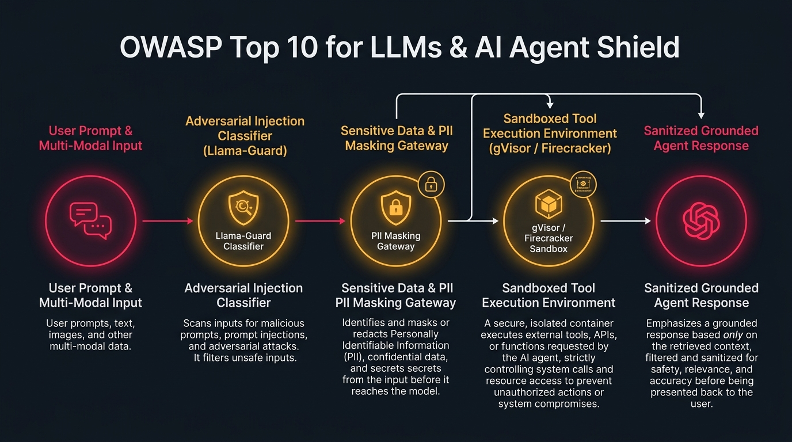

# OWASP Top 10 for LLMs & AI Agent Shield Studio

[](https://github.com/Pradeeptalari14/tp-owasp-llm-agent-shield/actions)
[](LICENSE)
[](https://talaripradeep.info/tools/owasp-llm-agent-shield/)
[](https://talaripradeep.info/studios/flow/?studio=owasp-llm-agent-shield)

> **Author:** [Talari Pradeep](https://talaripradeep.info) — Senior SRE & Platform Architect  
> **Interactive Studio Workspace:** [https://talaripradeep.info/tools/owasp-llm-agent-shield/](https://talaripradeep.info/tools/owasp-llm-agent-shield/)  
> **Visual Flow Canvas DAG:** [https://talaripradeep.info/studios/flow/?studio=owasp-llm-agent-shield](https://talaripradeep.info/studios/flow/?studio=owasp-llm-agent-shield)  
> **Documentation Guide:** [https://talaripradeep.info/tools/owasp-llm-agent-shield/learn.html](https://talaripradeep.info/tools/owasp-llm-agent-shield/learn.html)

---

## 1. System Architecture Flow



### Architectural Highlights
Protect agent swarms and RAG workflows against OWASP Top 10 for LLMs: prompt injections, insecure tool hijacking, sensitive data leakage, and denial of service.

* **Cryptographic Provenance:** Guarantees tamper-proof software supply chain attestation before deployment.
* **Deterministic Policy Gates:** Continuous enforcement against unauthorized container digests, bad dependencies, or untrusted inputs.
* **Zero Static Secrets:** Ephemeral identity validation avoiding long-lived bastion credentials.

---

## 2. Infrastructure & Software Technology Stack

| Category | Technology | Architectural Role |
| :--- | :--- | :--- |
| **Input & Output Shields** | `Meta Llama-Guard-3-8B`, `NeMo Guardrails 0.9+`, `Presidio PII Anonymizer` | Enterprise verification & telemetry |
| **Tool Execution Sandbox** | `Google gVisor (runsc)`, `AWS Firecracker MicroVMs`, `Seccomp Syscall Filtering` | Enterprise verification & telemetry |
| **Adversarial Telemetry** | `OpenTelemetry LLM Spans`, `Langfuse Attack Tracing`, `Automated Agent Circuit Breaker` | Enterprise verification & telemetry |

---

## 3. Primary Specification Manifest: `guardrails-config.yaml`

```yaml
guardrails:
  version: "2.0"
  owaspCompliance:
    llm01_prompt_injection:
      classifier: "meta-llama/Llama-Guard-3-8B"
      action: "BLOCK_AND_LOG"
    llm02_insecure_output:
      sanitizer: "html-escape-strict"
    llm06_sensitive_info:
      masking: "PII_REGEX_ENTITIES"
    llm08_tool_hijacking:
      humanInTheLoop: true
      sandbox: "gVisor"
```

---

## 4. Quickstart & Local Verification

### A. Clone and Validate
```bash
git clone https://github.com/Pradeeptalari14/tp-owasp-llm-agent-shield.git
cd tp-owasp-llm-agent-shield

# Execute SRE validation drill
chmod +x scripts/validate.sh
./scripts/validate.sh
```

### B. Run Implementation Automation
```bash
python3 main.py
```

---

## 5. Kubernetes & Docker Deployment

### Docker Run
```bash
docker build -t tp-owasp-llm-agent-shield:latest .
docker run --rm tp-owasp-llm-agent-shield:latest
```

### Kubernetes Admission Policy
```yaml
apiVersion: apps/v1
kind: Deployment
metadata:
  name: llm-agent-shield-proxy
spec:
  replicas: 3
  template:
    spec:
      runtimeClassName: gvisor
      containers:
        - name: agent-shield
          image: ghcr.io/pradeep/owasp-llm-shield:latest
          resources:
            limits:
              cpu: "2"
              memory: "4Gi"
```

---

## 6. SRE Runbook & Operational Verification

* **Verify Signatures & Telemetry:**
  ```bash
  cosign verify --certificate-identity-regexp '.*@github\.com' ghcr.io/pradeep/service:latest
  ```
* **Audit Rekor Transparency Log:**
  ```bash
  rekor-cli search --sha <IMAGE_SHA256_HASH>
  ```

---

## 7. License

Licensed under the [MIT License](LICENSE). Copyright (c) 2026 Talari Pradeep.
